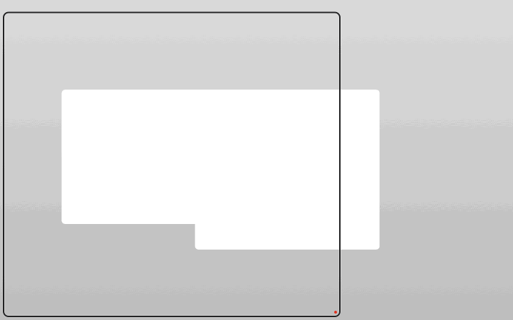
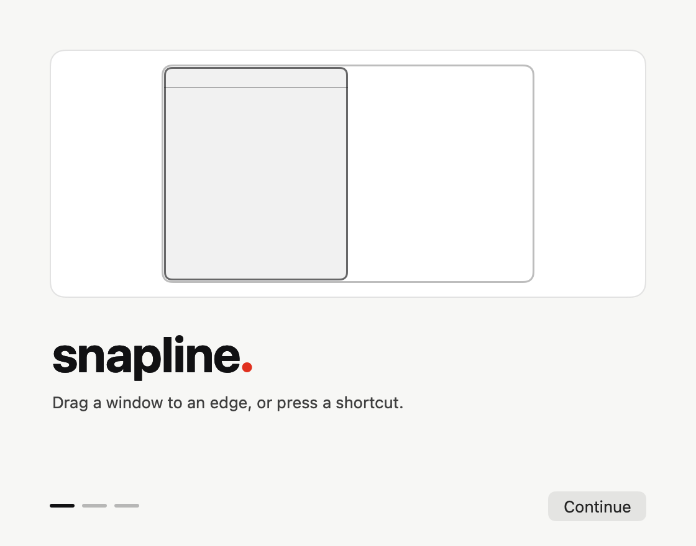
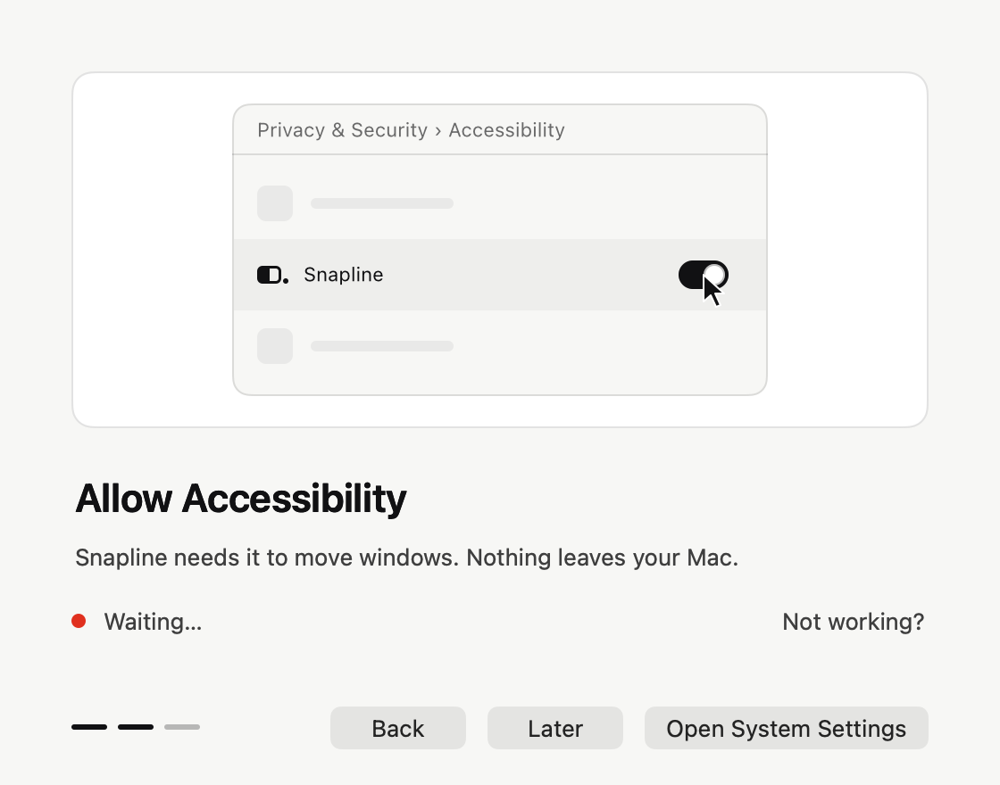
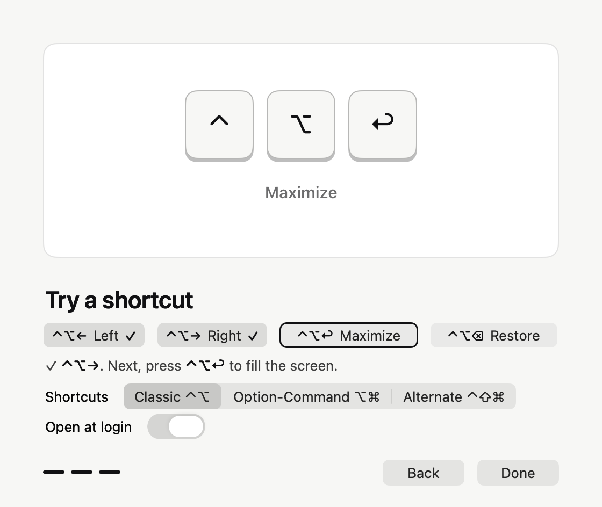
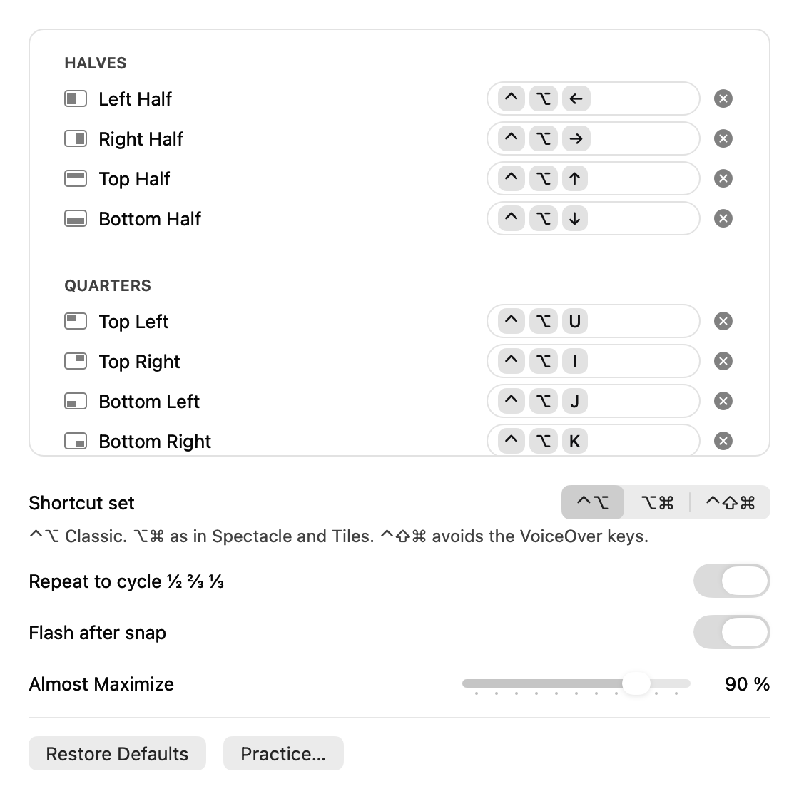
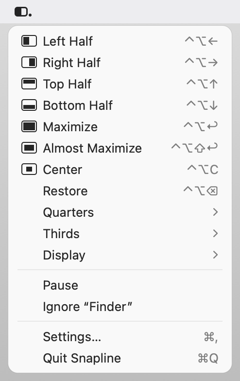

<p align="center">
  <picture>
    <source media="(prefers-color-scheme: dark)" srcset="docs/images/logo-dark.png">
    
  </picture>
</p>

<p align="center">
  English | <a href="README.tr.md">Türkçe</a>
</p>

<p align="center">
  <strong>Snap windows into place on your Mac — drag them to an edge, or press a shortcut.</strong>
</p>

<p align="center">
  Snapline is a small, honest window manager for macOS. Drag a window to an edge or a corner and a
  thin line shows exactly where it will land; let go and it is there. Prefer the keyboard? Twenty
  actions — halves, quarters, thirds, maximize, center, restore, next display — each one shortcut
  away, all re-assignable without touching the mouse. Public APIs only, no network, no telemetry.
</p>

<p align="center">
  <a href="https://github.com/htahaozlu/snapline/releases/latest/download/Snapline.dmg">
    
  </a>
</p>

<p align="center">
  <strong>Prefer Homebrew?</strong> <code>brew tap htahaozlu/snapline && brew install --cask htahaozlu/snapline/snapline</code>
</p>

<p align="center">
  <a href="https://github.com/htahaozlu/snapline/releases/latest"></a>
  
  
  
  <a href="LICENSE"></a>
  
</p>

<p align="center">
  <picture>
    <source media="(prefers-color-scheme: dark)" srcset="docs/images/hero-dark.svg">
    
  </picture>
</p>

## Why Snapline

- **The line shows, the period finishes.** While you drag, one line draws itself around the exact
  rectangle the window will fill — gaps and margins included. When the window lands, one red period
  marks it. Then nothing is left on screen.
- **Keyboard-first.** Every action has a shortcut, and recording a new one works entirely from the
  keyboard: <kbd>Space</kbd> records, <kbd>Esc</kbd> cancels, <kbd>⌫</kbd> clears, <kbd>Tab</kbd> moves
  on. Shortcuts already taken by macOS or by another app are explained, never silently swallowed.
- **Honest by construction.** Public Accessibility, CoreGraphics and Carbon APIs only — no private
  frameworks, no SIP changes, no synthetic input (the event tap only listens). No network code at
  all, no analytics, no updater, no entitlements. Every build is checked for this.
- **Measured, not claimed.** Idle CPU, memory, shortcut latency and startup are measured on every
  release with the scripts in this repository; the numbers below are the real ones, misses included.
- **Accessible.** VoiceOver names every control and announces every change; an alternate shortcut
  set keeps VoiceOver's own keys free; Reduce Motion, Increase Contrast and Full Keyboard Access are
  respected.

## Features

| | |
|---|---|
| **Drag to snap** | Edges for halves, corners for quarters, the top edge to maximize, the bottom edge in three segments for thirds. Hold <kbd>⇧</kbd> for an alternate map. Every zone is re-assignable. Dragging a snapped window gives it back its size. |
| **20 keyboard actions** | Halves, quarters, thirds, two-thirds, maximize, almost maximize, center, restore, next / previous display. Repeating a half cycles ½ → ⅔ → ⅓. |
| **Three shortcut sets** | *Classic* (<kbd>⌃⌥</kbd>, the community standard), *Option-Command* (<kbd>⌥⌘</kbd>, the Spectacle and Tiles layout — chosen for you when one of them is installed) and *Alternate* (<kbd>⌃⇧⌘</kbd>, never VoiceOver's <kbd>⌃⌥</kbd>). Or record your own. |
| **Practice built in** | The last setup screen is a short practice: it shows the keys you hold, ticks each shortcut that reaches Snapline, and says why when one does not. Reopen it any time from Settings › Shortcuts › **Practice…**. |
| **Your keyboard layout** | A shortcut is a key position, so it keeps working when you switch layouts; its label follows the layout you type with (Turkish Q shows `⌃⇧⌘Ü` where US shows `⌃⇧⌘]`). |
| **Calm feedback** | A short flash and an optional label on keyboard snaps; sound off by default; haptics on trackpads. |
| **Stays out of the way** | Gaps, app exclusions, launch at login, pause from the menu bar. Re-arms itself after sleep, user switching and Accessibility changes. |

<table>
  <tr>
    <td width="50%">
      <picture>
        <source media="(prefers-color-scheme: dark)" srcset="docs/images/app/overlay-drag-dark.gif">
        
      </picture>
      <p align="center"><sub>Drag preview — the line draws itself from the edge you touch.</sub></p>
    </td>
    <td width="50%">
      <picture>
        <source media="(prefers-color-scheme: dark)" srcset="docs/images/app/overlay-flash-dark.gif">
        
      </picture>
      <p align="center"><sub>Keyboard snap — one flash, one red period.</sub></p>
    </td>
  </tr>
</table>

## Install

### Direct download (DMG)

1. Download [**Snapline.dmg**](https://github.com/htahaozlu/snapline/releases/latest/download/Snapline.dmg)
   from the latest release (universal: Apple Silicon and Intel; macOS 14 Sonoma or later).
2. Open it and drag **Snapline** into **Applications**.
3. Launch it. Snapline is signed with a Developer ID and **notarized by Apple**, so it opens without a
   warning. Each release lists the DMG's SHA-256 next to it.

### Homebrew

```bash
brew tap htahaozlu/snapline
brew install --cask htahaozlu/snapline/snapline
```

Current Homebrew installs from a third-party tap only after you tap it. Always use the full name
`htahaozlu/snapline/snapline`: Homebrew's own repository has an unrelated cask called `snapline` (a
screenshot tool), and the short name installs that one. Upgrade with `brew upgrade --cask
htahaozlu/snapline/snapline` (a plain `brew upgrade` keeps to this tap too). Already installed from the
DMG? Add `--force` to the install to let Homebrew take it over.

### First launch: one permission

Snapline lives in the menu bar and asks for **Accessibility** only — macOS's permission to read and
move other apps' windows. No Input Monitoring, no Screen Recording, nothing leaves your Mac.

<table>
  <tr>
    <td width="33%"><picture><source media="(prefers-color-scheme: dark)" srcset="docs/images/app/onboarding-1-dark.png"></picture></td>
    <td width="33%"><picture><source media="(prefers-color-scheme: dark)" srcset="docs/images/app/onboarding-2-dark.png"></picture></td>
    <td width="33%"><picture><source media="(prefers-color-scheme: dark)" srcset="docs/images/app/onboarding-3-practice-dark.png"></picture></td>
  </tr>
</table>

The last screen is a practice. It shows only the keys of the next shortcut, presses the ones you
hold, ticks each shortcut that arrives and moves the window, and when a press goes elsewhere it
says where: <kbd>⌥⌘←</kbd> belongs to the *Option-Command* set (one click switches), Tiles is running
and holds the key, or the key reached the window instead of Snapline. The demo waits while you press
and carries on after a few quiet seconds.

If you say *Later*, Snapline stays usable: the menu bar icon shows the missing permission and the menu
leads with **Allow Accessibility…**. Turn the permission off later and Snapline notices within a
second; turn it back on and every shortcut comes back — no restart.

## Shortcuts

| Action | Classic | Option-Command | Alternate |
|---|---|---|---|
| Left / Right / Top / Bottom half | <kbd>⌃⌥</kbd> <kbd>←</kbd> <kbd>→</kbd> <kbd>↑</kbd> <kbd>↓</kbd> | <kbd>⌥⌘</kbd> <kbd>←</kbd> <kbd>→</kbd> <kbd>↑</kbd> <kbd>↓</kbd> | <kbd>⌃⇧⌘</kbd> <kbd>←</kbd> <kbd>→</kbd> <kbd>↑</kbd> <kbd>↓</kbd> |
| Quarters | <kbd>⌃⌥</kbd> <kbd>U</kbd> <kbd>I</kbd> <kbd>J</kbd> <kbd>K</kbd> | <kbd>⌥⌘</kbd> <kbd>U</kbd> <kbd>I</kbd> <kbd>J</kbd> <kbd>K</kbd> | <kbd>⌃⇧⌘</kbd> <kbd>U</kbd> <kbd>I</kbd> <kbd>J</kbd> <kbd>K</kbd> |
| First / Middle / Last third | <kbd>⌃⌥</kbd> <kbd>D</kbd> <kbd>F</kbd> <kbd>G</kbd> | <kbd>⇧⌥⌘</kbd> <kbd>D</kbd> <kbd>F</kbd> <kbd>G</kbd> | <kbd>⌃⇧⌘</kbd> <kbd>D</kbd> <kbd>F</kbd> <kbd>G</kbd> |
| First / Middle / Last two thirds | <kbd>⌃⌥</kbd> <kbd>E</kbd> <kbd>R</kbd> <kbd>T</kbd> | <kbd>⌃⌘</kbd> <kbd>←</kbd> <kbd>↑</kbd> <kbd>→</kbd> | <kbd>⌃⇧⌘</kbd> <kbd>E</kbd> <kbd>R</kbd> <kbd>T</kbd> |
| Maximize / Almost maximize | <kbd>⌃⌥↩</kbd> / <kbd>⌃⌥⇧↩</kbd> | <kbd>⌥⌘F</kbd> / <kbd>⇧⌥⌘↩</kbd> | <kbd>⌃⇧⌘↩</kbd> / <kbd>⌃⇧⌘M</kbd> |
| Center / Restore | <kbd>⌃⌥C</kbd> / <kbd>⌃⌥⌫</kbd> | <kbd>⌥⌘C</kbd> / <kbd>⌥⌘Y</kbd> | <kbd>⌃⇧⌘C</kbd> / <kbd>⌃⇧⌘⌫</kbd> |
| Next / Previous display | <kbd>⌃⌥⌘→</kbd> / <kbd>⌃⌥⌘←</kbd> | <kbd>⌃⌥⌘→</kbd> / <kbd>⌃⌥⌘←</kbd> | <kbd>⌃⇧⌘]</kbd> / <kbd>⌃⇧⌘[</kbd> |

**Coming from Spectacle or Tiles?** *Option-Command* is their layout (<kbd>⌥⌘D</kbd> stays the Dock's,
so thirds add <kbd>⇧</kbd>), and Snapline starts on it when it finds one of them installed. Quit the
other app: two window managers on the same keys means one of them never gets the press.

While VoiceOver runs, <kbd>⌃⌥</kbd> shortcuts step aside so VoiceOver keeps its keys (unless you use
Caps Lock as the VoiceOver key and say so in Settings).

### Recording a shortcut — without the mouse

Settings › Shortcuts is one list; <kbd>Tab</kbd> lands on it, the arrows pick an action.

| Key | While recording |
|---|---|
| <kbd>Space</kbd> / <kbd>↩</kbd> | Start recording the selected action. Every Snapline shortcut is released meanwhile, so none of them fires by accident. |
| <kbd>Esc</kbd> | Cancel. The old shortcut stays — VoiceOver says so. |
| <kbd>⌫</kbd> / <kbd>⌦</kbd> | Clear the shortcut. |
| <kbd>Tab</kbd> / <kbd>⇧Tab</kbd> | Leave the recorder; focus moves to the next / previous control. |
| a combination | Saved and registered once. A key with no modifier, <kbd>⌘</kbd>-only combinations (apps own those) and shortcuts macOS uses (Mission Control, Spotlight, screenshots…) are refused with the reason; recording goes on. |

If another app already holds the combination, Snapline keeps your previous shortcut and tells you
(`⌃⌥X is in use by another app. Kept ⌃⌥←.`). Two of Snapline's own actions on one combination get a
**Swap** / **Cancel** choice.

<p align="center">
  <picture>
    <source media="(prefers-color-scheme: dark)" srcset="docs/images/app/settings-shortcuts-dark.png">
    
  </picture>
  &nbsp;
  <picture>
    <source media="(prefers-color-scheme: dark)" srcset="docs/images/app/menu-dark.png">
    
  </picture>
</p>

## Privacy and integrity

- **No network.** Snapline links no networking framework and imports no socket, URL session or
  resolver symbol (0 of 828 imported symbols). It never checks for updates.
- **No private APIs.** No SkyLight / CGS calls, not even the `_AXUIElementGetWindow` that every
  competitor we inspected uses. Two documented-but-undeclared HIToolbox functions are looked up at
  run time and are optional: the display's usable frame and the read-only list of macOS's own
  shortcuts.
- **No synthetic input.** The event tap is listen-only; Snapline never posts an event.
- **No entitlements, hardened runtime, notarized.** It writes its preferences and, if you turn sound
  on, a small sound cache. That is all.

`scripts/integrity.sh` checks all of this against the built app (`otool`, `nm`, `codesign`) and fails on
any violation.

## Performance

Measured on an Apple M3 (macOS 26.5) with `scripts/bench.sh` — Snapline's own test window only; full
method and raw data in [docs/BENCHMARKS.md](docs/BENCHMARKS.md).

| | |
|---|---|
| Idle CPU | **0.03 %** mean, 0 wakeups (12 samples × 5 s) |
| Memory, fresh | **12–15 MB** physical footprint (depends on the machine's state; same in the previous release) |
| Action → window moved (core path, 300 actions) | **p50 1.4 ms, p95 3–10 ms**, 300 / 300 placed within 2 pt |
| An app that hangs | Snapline gives up after **≤ 505 ms** and carries on |
| Startup | **82 ms** median to ready |
| Size | **842 kB** (Apple Silicon slice), 1.76 MB universal; one binary, no frameworks |

Known: after Settings has been opened, macOS's own rendering caches for its controls stay in the
process (about 30–60 MB after many openings) and wake it briefly a few times a second at ~0 % CPU.
They are the system's, not Snapline's code (details and measurements in docs/BENCHMARKS.md); reducing
them is the next performance item.

## Build from source

Requirements: macOS 14+, [Zig 0.17](https://ziglang.org/download/), Xcode command line tools.

```sh
zig build test                 # core unit tests + C ABI layout check
scripts/snapshot.sh            # offscreen renders + behaviour suites (recorder, keyboard, recovery)
scripts/build-app.sh           # build/Snapline.app, signed with your local identity if you have one
NOKTA_ALLOW_UNSIGNED_BUILD=1 NOKTA_BUILD_DIR=build/adhoc scripts/build-app.sh   # ad-hoc, no keychain
scripts/bench.sh               # benchmarks against Snapline's own test window
scripts/release.sh             # universal, Developer ID–signed, notarized Snapline.dmg (maintainers)
```

An ad-hoc build has no stable code identity, so macOS asks for Accessibility again after every build;
`scripts/setup-signing.sh --create` makes a local signing identity that keeps the permission.

### How it is built

```
Swift / AppKit shell (app/Sources)  ── C ABI (core/include/nokta.h) ──  Zig core (core/src)
 menu · settings · onboarding · overlay                               engine · layout · zones · rules
                                                                       AX · Carbon hotkeys ·
                                                                       listen-only event tap · AXObserver
```

Everything runs on the main run loop and is event driven: no polling, no timers while idle. The
project started as **Nokta** (Turkish for "period") — the code, the C core and the engineering notes in
[docs/](docs) still use that working name.

## FAQ

**Snapline doesn't move windows after an update.** Open System Settings › Privacy & Security ›
Accessibility, remove Snapline with **−** and add it again. (Releases are signed with the same
Developer ID, so this should be rare.)

**A shortcut says "in use by another app".** Another window manager or utility registered it first.
Quit it or pick another combination — Snapline kept your previous one.

**I press a shortcut and nothing happens.** Open Settings › Shortcuts › **Practice…** and press it
there. The practice says what became of the press: a shortcut of another set (switch the set right
there), a key another app holds (it names Tiles, Spectacle, Rectangle, Magnet or Moom when they run),
or a key that reached the window instead of Snapline.

**Does it work with Rectangle / Magnet / Tiles running?** Yes, but whichever app registers a combination
first gets it. Snapline shows which of its shortcuts could not be registered, and registers them as
soon as an app quits and frees them.

**Does it send anything anywhere?** No. There is no network code in the app at all.

## License

[MIT](LICENSE) © 2026 Hasan Taha Ozlu
