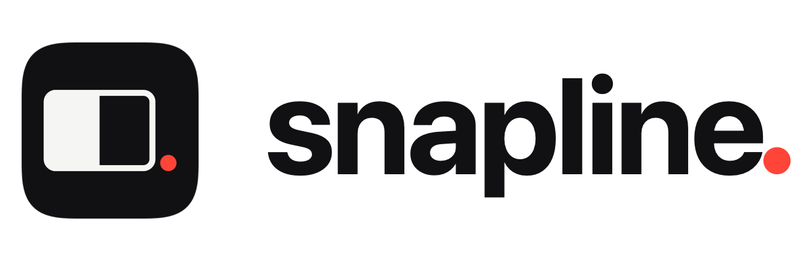
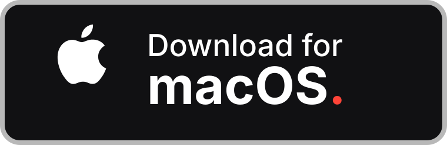

<p align="center">
  <picture>
    <source media="(prefers-color-scheme: dark)" srcset="docs/images/logo-dark.png">
    
  </picture>
</p>

<p align="center">
  <a href="README.md">English</a> | Türkçe
</p>

<p align="center">
  <strong>Mac'te pencereleri yerine oturtun — kenara sürükleyin ya da bir kısayola basın.</strong>
</p>

<p align="center">
  Snapline, macOS için küçük ve dürüst bir pencere yöneticisi. Bir pencereyi kenara ya da köşeye
  sürükleyin; ince bir çizgi tam olarak nereye oturacağını gösterir, bırakınca oradadır. Klavyeyi mi
  seversiniz? Yirmi eylem — yarılar, çeyrekler, üçte birler, büyütme, ortalama, geri alma, diğer
  ekran — her biri tek kısayol uzakta ve fareye dokunmadan yeniden atanabilir. Yalnız açık API,
  ağ yok, telemetri yok.
</p>

<p align="center">
  <a href="https://github.com/htahaozlu/snapline/releases/latest/download/Snapline.dmg">
    
  </a>
</p>

<p align="center">
  <strong>Homebrew mu?</strong> <code>brew tap htahaozlu/snapline && brew install --cask htahaozlu/snapline/snapline</code>
</p>

<p align="center">
  <a href="https://github.com/htahaozlu/snapline/releases/latest"></a>
  
  
  
  <a href="LICENSE"></a>
</p>

<p align="center">
  <picture>
    <source media="(prefers-color-scheme: dark)" srcset="docs/images/hero-dark.svg">
    
  </picture>
</p>

## Neden Snapline

- **Çizgi gösterir, nokta bitirir.** Sürüklerken tek bir çizgi, pencerenin dolduracağı dikdörtgeni
  (boşluklar dahil) kendiliğinden çizer. Pencere yerine oturunca tek bir kırmızı nokta onu işaretler.
  Sonra ekranda hiçbir şey kalmaz.
- **Önce klavye.** Her eylemin kısayolu var; yenisini kaydetmek tamamen klavyeyle olur:
  <kbd>Space</kbd> kaydeder, <kbd>Esc</kbd> iptal eder, <kbd>⌫</kbd> temizler, <kbd>Tab</kbd> sonraki
  kontrole geçer. macOS'un ya da başka bir uygulamanın kullandığı kısayollar sessizce yutulmaz, nedeni söylenir.
- **Tasarımı gereği dürüst.** Yalnız açık Accessibility, CoreGraphics ve Carbon API'leri — özel
  framework yok, SIP değişikliği yok, sentetik girdi yok (event tap yalnız dinler). Ağ kodu yok,
  analitik yok, güncelleyici yok, entitlement yok. Her build bunun için denetlenir.
- **İddia değil ölçüm.** Boşta CPU, bellek, kısayol gecikmesi ve açılış her sürümde bu repodaki
  betiklerle ölçülür; aşağıdaki sayılar gerçek sayılardır, kaçırılan hedefler dahil.
- **Erişilebilir.** VoiceOver her kontrolü adlandırır ve her değişikliği duyurur; alternatif kısayol
  seti VoiceOver'ın kendi tuşlarını boş bırakır; Hareketi Azalt, Kontrastı Artır ve Tam Klavye Erişimi
  desteklenir.

## Özellikler

| | |
|---|---|
| **Sürükle-bırak** | Kenarlar yarılar, köşeler çeyrekler, üst kenar büyütme, alt kenar üç parçada üçte birler. <kbd>⇧</kbd> ile alternatif harita. Her bölge yeniden atanabilir. Yerleştirilmiş pencereyi sürükleyince eski boyutuna döner. |
| **20 klavye eylemi** | Yarılar, çeyrekler, üçte birler, üçte ikiler, büyütme, neredeyse büyütme, ortalama, geri alma, sonraki / önceki ekran. Aynı yarıya tekrar basınca ½ → ⅔ → ⅓. |
| **Üç kısayol seti** | *Classic* (<kbd>⌃⌥</kbd>, topluluk standardı), *Option-Command* (<kbd>⌥⌘</kbd>, Spectacle ve Tiles düzeni — biri kuruluysa kendiliğinden seçilir) ve *Alternate* (<kbd>⌃⇧⌘</kbd>, VoiceOver'ın <kbd>⌃⌥</kbd>'sine hiç dokunmaz). Ya da kendi kısayollarınız. |
| **Yerleşik alıştırma** | Kurulumun son ekranı kısa bir alıştırma: bastığınız tuşları gösterir, Snapline'a ulaşan her kısayolu işaretler, ulaşmayanın nedenini söyler. Settings › Shortcuts › **Practice…** ile her zaman yeniden açılır. |
| **Sizin klavye düzeniniz** | Kısayol bir tuş konumudur; düzen değişince de çalışır. Gösterilen ad ise yazdığınız düzenden gelir (Türkçe Q'da `⌃⇧⌘Ü`, US'de `⌃⇧⌘]`). |
| **Sakin geri bildirim** | Klavyeyle yerleştirmede kısa bir parlama ve isteğe bağlı etiket; ses varsayılan kapalı; trackpad'de dokunsal geri bildirim. |
| **Ayak altında dolaşmaz** | Boşluklar, uygulama hariç tutma, girişte açılma, menü çubuğundan duraklatma. Uyku, kullanıcı değişimi ve Accessibility değişikliklerinden sonra kendini yeniden kurar. |

## Kurulum

### Doğrudan indirme (DMG)

1. Son sürümden [**Snapline.dmg**](https://github.com/htahaozlu/snapline/releases/latest/download/Snapline.dmg)
   dosyasını indirin (universal: Apple Silicon ve Intel; macOS 14 Sonoma ya da üstü).
2. Açın ve **Snapline**'ı **Uygulamalar**'a sürükleyin.
3. Başlatın. Snapline Developer ID ile imzalı ve **Apple tarafından notarize** edilmiştir; uyarı
   vermeden açılır. Her sürüm DMG'nin SHA-256'sını yanında listeler.

### Homebrew

```bash
brew tap htahaozlu/snapline
brew install --cask htahaozlu/snapline/snapline
```

Güncel Homebrew üçüncü taraf tap'ten ancak tap eklendikten sonra kurar. Her zaman tam adı
`htahaozlu/snapline/snapline` kullanın: Homebrew'ün kendi deposunda ilgisiz bir `snapline` cask'ı (ekran
görüntüsü aracı) var; kısa ad onu kurar. Güncelleme: `brew upgrade --cask htahaozlu/snapline/snapline`
(düz `brew upgrade` da bu tap'e bağlı kalır). DMG'den kurduysanız Homebrew'ün devralması için kuruluma
`--force` ekleyin.

### İlk açılış: tek izin

Snapline menü çubuğunda yaşar ve yalnız **Accessibility** (Erişilebilirlik) iznini ister — macOS'un başka
uygulamaların pencerelerini okuma ve taşıma izni. Input Monitoring yok, Screen Recording yok, hiçbir
şey Mac'inizden çıkmaz.

Son ekran bir alıştırma. Yalnız sıradaki kısayolun tuşlarını gösterir, tuttuklarınızı basılı çizer, gelip pencereyi taşıyan her kısayolu işaretler; bir basış başka yere giderse nereye
gittiğini söyler: <kbd>⌥⌘←</kbd> *Option-Command* setinindir (tek tıkla geçilir), Tiles açık ve tuşu
tutuyor, ya da tuş Snapline yerine pencereye ulaştı. Siz bastıkça demo bekler, birkaç saniye sessizlikten
sonra devam eder.

*Later* derseniz Snapline kullanılabilir kalır: menü çubuğu ikonu eksik izni
gösterir, menü **Allow Accessibility…** ile başlar. İzni sonradan kapatırsanız Snapline bunu bir saniye
içinde fark eder; geri açınca tüm kısayollar yeniden başlatma gerekmeden döner.

## Kısayollar

| Eylem | Classic | Option-Command | Alternate |
|---|---|---|---|
| Sol / Sağ / Üst / Alt yarı | <kbd>⌃⌥</kbd> <kbd>←</kbd> <kbd>→</kbd> <kbd>↑</kbd> <kbd>↓</kbd> | <kbd>⌥⌘</kbd> <kbd>←</kbd> <kbd>→</kbd> <kbd>↑</kbd> <kbd>↓</kbd> | <kbd>⌃⇧⌘</kbd> <kbd>←</kbd> <kbd>→</kbd> <kbd>↑</kbd> <kbd>↓</kbd> |
| Çeyrekler | <kbd>⌃⌥</kbd> <kbd>U</kbd> <kbd>I</kbd> <kbd>J</kbd> <kbd>K</kbd> | <kbd>⌥⌘</kbd> <kbd>U</kbd> <kbd>I</kbd> <kbd>J</kbd> <kbd>K</kbd> | <kbd>⌃⇧⌘</kbd> <kbd>U</kbd> <kbd>I</kbd> <kbd>J</kbd> <kbd>K</kbd> |
| Birinci / Orta / Son üçte bir | <kbd>⌃⌥</kbd> <kbd>D</kbd> <kbd>F</kbd> <kbd>G</kbd> | <kbd>⇧⌥⌘</kbd> <kbd>D</kbd> <kbd>F</kbd> <kbd>G</kbd> | <kbd>⌃⇧⌘</kbd> <kbd>D</kbd> <kbd>F</kbd> <kbd>G</kbd> |
| Birinci / Orta / Son üçte iki | <kbd>⌃⌥</kbd> <kbd>E</kbd> <kbd>R</kbd> <kbd>T</kbd> | <kbd>⌃⌘</kbd> <kbd>←</kbd> <kbd>↑</kbd> <kbd>→</kbd> | <kbd>⌃⇧⌘</kbd> <kbd>E</kbd> <kbd>R</kbd> <kbd>T</kbd> |
| Büyüt / Neredeyse büyüt | <kbd>⌃⌥↩</kbd> / <kbd>⌃⌥⇧↩</kbd> | <kbd>⌥⌘F</kbd> / <kbd>⇧⌥⌘↩</kbd> | <kbd>⌃⇧⌘↩</kbd> / <kbd>⌃⇧⌘M</kbd> |
| Ortala / Geri al | <kbd>⌃⌥C</kbd> / <kbd>⌃⌥⌫</kbd> | <kbd>⌥⌘C</kbd> / <kbd>⌥⌘Y</kbd> | <kbd>⌃⇧⌘C</kbd> / <kbd>⌃⇧⌘⌫</kbd> |
| Sonraki / Önceki ekran | <kbd>⌃⌥⌘→</kbd> / <kbd>⌃⌥⌘←</kbd> | <kbd>⌃⌥⌘→</kbd> / <kbd>⌃⌥⌘←</kbd> | <kbd>⌃⇧⌘]</kbd> / <kbd>⌃⇧⌘[</kbd> |

**Spectacle ya da Tiles'tan mı geliyorsunuz?** *Option-Command* onların düzeni (<kbd>⌥⌘D</kbd> Dock'ta
kalır, bu yüzden üçte birlere <kbd>⇧</kbd> eklenir); Snapline bunlardan biri kuruluysa bu setle başlar.
Diğer uygulamadan çıkın: aynı tuşlarda iki pencere yöneticisi olunca biri basışı hiç almaz.

**Kısayola basıyorum, hiçbir şey olmuyor.** Settings › Shortcuts › **Practice…** açıp orada basın.
Alıştırma basışın ne olduğunu söyler: başka bir setin kısayolu (seti orada değiştirin), başka bir
uygulamanın tuttuğu tuş (Tiles, Spectacle, Rectangle, Magnet ya da Moom açıksa adını verir) ya da
Snapline yerine pencereye ulaşan bir tuş.

### Kısayol kaydetmek — faresiz

| Tuş | Kayıt sırasında |
|---|---|
| <kbd>Space</kbd> / <kbd>↩</kbd> | Seçili eylem için kaydı başlatır. Bu sırada Snapline kısayollarının hiçbiri kayıtlı değildir, yanlışlıkla çalışmaz. |
| <kbd>Esc</kbd> | İptal. Eski kısayol kalır; VoiceOver da bunu söyler. |
| <kbd>⌫</kbd> / <kbd>⌦</kbd> | Kısayolu temizler. |
| <kbd>Tab</kbd> / <kbd>⇧Tab</kbd> | Kayıttan çıkar; odak sonraki / önceki kontrole geçer. |
| bir kombinasyon | Kaydedilir ve tek kez bağlanır. Değiştiricisiz tuşlar, yalnız <kbd>⌘</kbd>'li kombinasyonlar (uygulamaların) ve macOS'un kullandıkları (Mission Control, Spotlight, ekran görüntüsü…) nedeniyle reddedilir; kayıt sürer. |

Kombinasyonu başka bir uygulama tutuyorsa Snapline önceki kısayolunuzu korur ve söyler
(`⌃⌥X is in use by another app. Kept ⌃⌥←.`).

## Gizlilik ve bütünlük

Ağ framework'ü yok, soket / URL oturumu / DNS sembolü yok (828 içe aktarılan sembolden 0), güncelleme
denetimi yok; özel API yok; sentetik girdi yok; entitlement yok, hardened runtime, notarize.
`scripts/integrity.sh` bunu build edilmiş uygulamada denetler.

## Performans

Apple M3 (macOS 26.5), `scripts/bench.sh` ile; yöntem ve ham veri [docs/BENCHMARKS.md](docs/BENCHMARKS.md)'de.

| | |
|---|---|
| Boşta CPU | ort. **%0,03**, 0 uyanma |
| Bellek, taze | **12–15 MB** fiziksel footprint |
| Eylem → pencere taşındı (çekirdek yolu, 300 eylem) | **p50 1,4 ms, p95 3–10 ms**, 300 / 300 doğru yerde |
| Açılış | medyan **82 ms** |
| Boyut | **842 kB** (Apple Silicon), universal 1,76 MB |

Bilinen: Settings açıldıktan sonra macOS'un kontrollerine ait çizim önbellekleri süreçte kalır (çok kez
açınca ~30–60 MB) ve %0 CPU ile saniyede birkaç kez kısa uyanır. Bunlar sistemin, Snapline kodunun
değil; azaltmak sıradaki performans işi.

## Kaynaktan build

macOS 14+, [Zig 0.17](https://ziglang.org/download/), Xcode komut satırı araçları.

```sh
zig build test && scripts/snapshot.sh && scripts/build-app.sh
```

Proje **Nokta** adıyla başladı; kod, C çekirdeği ve [docs/](docs) içindeki mühendislik notları bu çalışma
adını kullanmaya devam ediyor.

## Lisans

[MIT](LICENSE) © 2026 Hasan Taha Ozlu
